<h1 align="center">BrandForge Frontend</h1>

<div align="center">

> The single-page **React** client for **BrandForge** — a platform that connects **brands** and **content creators** through structured campaigns, contests, and submissions.


</div>

This repository contains the **frontend only**. It is a Vite-powered React SPA that talks to the BrandForge REST API over HTTPS using cookie-based JWT authentication. The backend lives in a separate repository (`BrandForge_backend`) deployed on Render at `https://brandforge-backend.onrender.com`.


---

<h2 align="center">Table of Contents</h2>

- [Overview](#overview)
- [Feature Highlights](#feature-highlights)
- [Tech Stack](#tech-stack)
- [System Architecture](#system-architecture)
- [Application Bootstrap](#application-bootstrap)
- [Routing & Guards](#routing--guards)
- [Project Structure](#project-structure)
- [Component Architecture](#component-architecture)
- [Authentication Flow](#authentication-flow)
- [Admin Dashboard](#admin-dashboard)
- [Brand Dashboard](#brand-dashboard)
- [Creator Dashboard](#creator-dashboard)
- [API Integration Map](#api-integration-map)
- [Client-Side Validation](#client-side-validation)
- [Cold-Start Resilience](#cold-start-resilience)
- [Winner Selection Flow](#winner-selection-flow)
- [Styling & Design System](#styling--design-system)
- [Codebase Distribution](#codebase-distribution)
- [Getting Started](#getting-started)
- [Configuration](#configuration)
- [Deployment](#deployment)
- [Conventions](#conventions)
- [Known Limitations](#known-limitations)
- [Roadmap](#roadmap)
- [Contributing](#contributing)

---

<h2 align="center">Overview</h2>

BrandForge's frontend is a **role-aware SPA**: after login, every user lands on one of three bespoke dashboards —

- **Brands** launch campaign briefs (title, description, reward, deadline), watch them go through admin approval, review creator pitches, and crown winners.
- **Creators** browse approved campaign briefs, submit content links, and track their wins and earnings.
- **Admins** review the queue of pending campaigns and approve them into the public marketplace.

The app is deliberately lightweight — **no state-management library, no TypeScript**. It relies on React 19 function components with hooks, one shared axios instance, one AuthContext, and a hybrid styling layer: **Tailwind CSS 4** utilities composed on top of a large hand-written **glassmorphic custom stylesheet**.

<h3 align="center">At a Glance</h3>

| Property | Value |
| --- | --- |
| App type | Single-page application (SPA) |
| Entry point | `src/main.jsx` |
| UI library | React 19 (function components + hooks only) |
| Routing | React Router 7 (`BrowserRouter`) |
| HTTP client | Single axios instance with `withCredentials: true` |
| Authentication | JWT in `httpOnly` cookie — never touched by JS |
| State management | Local `useState` + one `AuthContext` |
| Styling | Tailwind CSS 4 (`@tailwindcss/vite`) + hand-written glassmorphic CSS |
| Notifications | react-hot-toast (top-right, white theme, 3.5s auto-close) |
| Celebrations | react-confetti (winner selection) |
| Dev server | `http://localhost:5173` (Vite default) |
| Production | Vercel — `https://brand-forge-frontend.vercel.app` |
| API base URL | `https://brandforge-backend.onrender.com` (Render, free tier) |

---

<h2 align="center">Feature Highlights</h2>

<h3 align="center">Authentication &amp; Session</h3>
- Split-screen Login/Register with animated **canvas particle-network** background and glass showcase panel
- Real-time, field-level form validation with `touched` / `error` state and valid/invalid styling
- Role selector at registration (Creator / Brand) — admin is deliberately not offered in the UI
- Session restore on every reload via a single-shot `GET /api/auth/me`, with a branded spinner while it resolves
- Logout confirmation modal ("Are you sure you want to log out?") with Escape-key dismiss

<h3 align="center">Role Dashboards</h3>
- **Admin** — pending-campaign review grid, one-click approval, stats cards, detail modal, shimmer loading skeletons
- **Brand** — campaign brief launcher with full client-side validation, owned-campaign list with status badges, submissions viewer, winner selection with confetti celebration, budget stat with commission deduction
- **Creator** — win/earnings cards with payout amounts and platform-fee note, congratulations banner, campaign brief marketplace, submit-pitch modal with content guidelines

<h3 align="center">Platform UX</h3>
- Role-based redirect from `/` straight to the correct dashboard
- Route guards that trust `AuthContext` — unauthenticated or wrong-role users go to `/login` before any dashboard renders
- Toast notifications (`react-hot-toast`) for every API success/failure
- Free-tier cold-start handling: the 12s axios timeout turns a sleeping Render instance into a fast logged-out state instead of a hung UI
- Creator "Total won" badge in the navbar with aggregated earnings and fee tooltip
- Fully responsive layouts with mobile breakpoints

---

<h2 align="center">Tech Stack</h2>

| Layer | Technology | Version | Purpose |
| --- | --- | --- | --- |
| UI library | React + React DOM | `^19.2.0` | Component rendering, hooks |
| Bundler / dev server | Vite | `^7.2.4` | Dev server with HMR, production builds |
| Vite plugin | @vitejs/plugin-react | `^5.1.1` | JSX transform + Fast Refresh |
| Routing | react-router-dom | `^7.11.0` | `BrowserRouter`, `Routes`, `Navigate` |
| HTTP client | axios | `^1.13.2` | API calls with cookie credentials; 12s timeout |
| Notifications | react-hot-toast | `^2.4.1` | Success/error toasts (`<Toaster position="top-right">`, 3.5s) |
| Celebration | react-confetti | `^6.4.0` | Confetti burst on winner selection |
| Styling | Tailwind CSS 4 | `^4.1.18` | Utility classes, `@import "tailwindcss"` in `global.css` |
| Styling (build) | @tailwindcss/vite | `^4.1.18` | Tailwind Vite plugin |
| Custom CSS | Vanilla CSS | — | Hand-written glassmorphic theme in one global stylesheet |
| Linting | ESLint (flat config) | `^9.39.1` | `eslint-plugin-react-hooks`, `react-refresh` |
| Language | JavaScript (ES modules) | — | No TypeScript |
| Deployment | Vercel | — | Static hosting with SPA rewrites |

> There is no test framework configured. `npm run lint` is the only static check. The older `react-toastify` (`^11.0.5`) is still listed in `package.json` but is no longer imported anywhere — all notifications go through `react-hot-toast`.

---

<h2 align="center">System Architecture</h2>

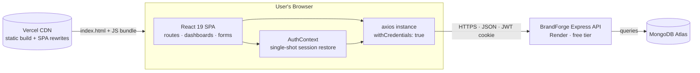

**Key ideas**

- The SPA is served as static files from Vercel; all data is fetched from the Render-hosted API at runtime.
- Authentication rides entirely on the `token` **httpOnly cookie** — the frontend never reads, stores, or transmits the JWT itself; axios simply sends `withCredentials: true`.
- Every page-level component owns its local state; the only shared state is the authenticated `user` in `AuthContext`.

---

<h2 align="center">Application Bootstrap</h2>

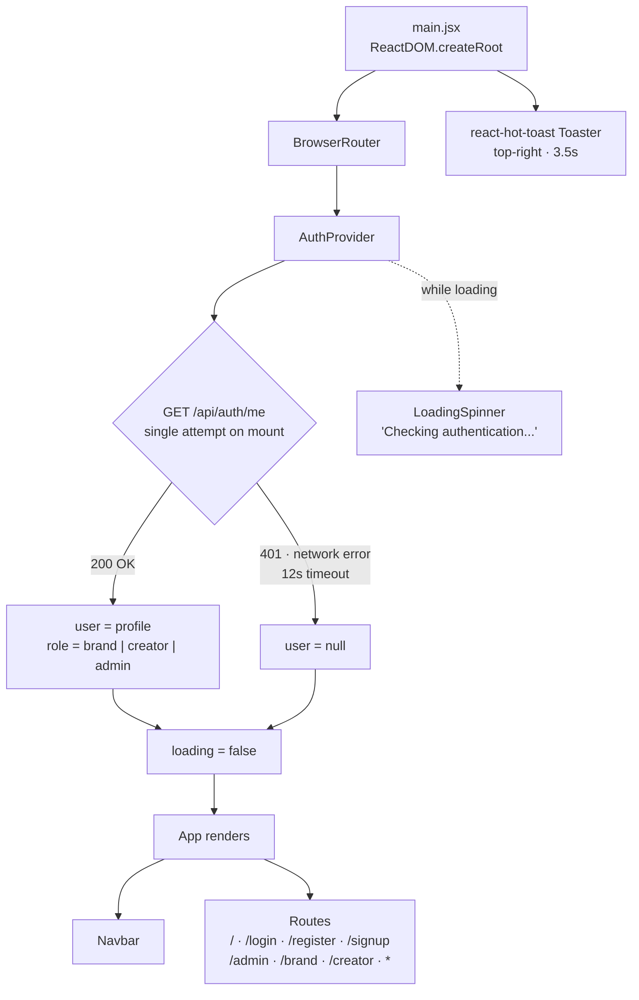

Session restore is a **single-shot** `GET /api/auth/me` guarded by an `isMounted` flag — there is **no retry loop**. If the free-tier Render instance is asleep, axios aborts after its **12-second timeout** and the app falls back to the logged-out state, showing the login page instead of hanging on a splash screen. The branded `LoadingSpinner` covers the initial check; dashboard fetches that hit a cold start surface a toast and the user retries manually.

---

<h2 align="center">Routing &amp; Guards</h2>

<h3 align="center">Route Table</h3>

| Path | Component | Access |
| --- | --- | --- |
| `/` | `HomeRedirect` | Redirects by role (or to `/login`) |
| `/login` | `Login` | Public |
| `/register` | `Register` | Public |
| `/signup` | `Register` | Public alias of `/register` |
| `/admin` | `AdminDashboard` | `ProtectedRoute role="admin"` |
| `/brand` | `BrandDashboard` | `ProtectedRoute role="brand"` |
| `/creator` | `CreatorDashboard` | `ProtectedRoute role="creator"` |
| `*` | — | `Navigate` back to `/` (then role redirect) |

<h3 align="center">Guard Decision Flow</h3>

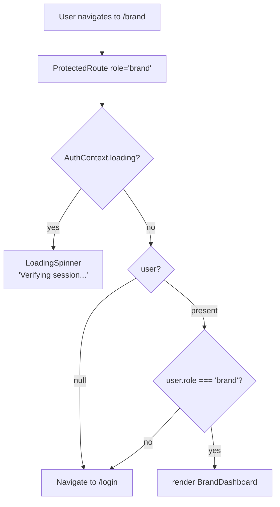

`ProtectedRoute` is a pure context consumer: it never calls the API itself, it only reads `user` and `loading` from `AuthContext`, which performs the single `/api/auth/me` request. `HomeRedirect` shows the same spinner (`"Checking authentication..."`) until loading settles, then switches on role — admin → `/admin`, brand → `/brand`, creator → `/creator`, otherwise → `/login`. Unknown paths hit the catch-all and re-enter that same redirect.

---

<h2 align="center">Project Structure</h2>

```text
BrandForge_Frontend/
├── index.html                    # Shell: favicon, viewport, #root mount
├── vercel.json                   # SPA rewrite: all routes → /index.html
├── vite.config.js                # Vite + React + Tailwind plugins
├── eslint.config.js              # ESLint 9 flat config
├── public/                       # favicon.png, logo.png, vite.svg
└── src/
    ├── main.jsx                  # Bootstrap: BrowserRouter → AuthProvider → App + Toaster
    ├── App.jsx                   # Route table, /signup alias, catch-all, role home redirect
    ├── api/
    │   └── axios.js              # Single axios instance (baseURL + credentials + 12s timeout)
    ├── auth/
    │   ├── Login.jsx             # Split-screen login + demo quick-fill + validation
    │   └── Register.jsx          # Registration: role cards, password strength, validation
    ├── components/
    │   ├── Navbar.jsx            # Brand bar, profile capsule, logout modal
    │   ├── ProtectedRoute.jsx    # Role guard backed by AuthContext (no API call)
    │   ├── LoadingSpinner.jsx    # Branded spinner for session checks
    │   └── ServerLoadingScreen.jsx # Legacy warm-up screen — no longer imported
    ├── context/
    │   └── AuthContext.jsx       # user state, single-shot session restore, logout
    ├── pages/
    │   ├── AdminDashboard.jsx    # Pending campaign review + approval
    │   ├── BrandDashboard.jsx    # Campaign creation, submissions, winner selection
    │   └── CreatorDashboard.jsx  # Brief marketplace, submissions, wins & earnings
    ├── utils/
    │   └── creatorPrizes.js      # Prize parsing, currency totals, win→campaign resolution
    └── styles/
        └── global.css            # Tailwind import + theme variables, navbar, auth, shared UI
```

---

<h2 align="center">Component Architecture</h2>

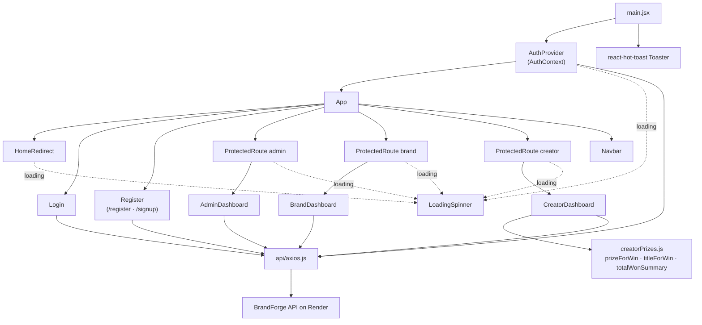

`LoadingSpinner` (a 34-line branded spinner with a "B" core and dot bar) is the only loading UI still referenced — `ServerLoadingScreen` remains on disk but nothing imports it. `Navbar` is display-only: it reads the user from context and renders the profile capsule, with no data fetching of its own.

---

<h2 align="center">Authentication Flow</h2>

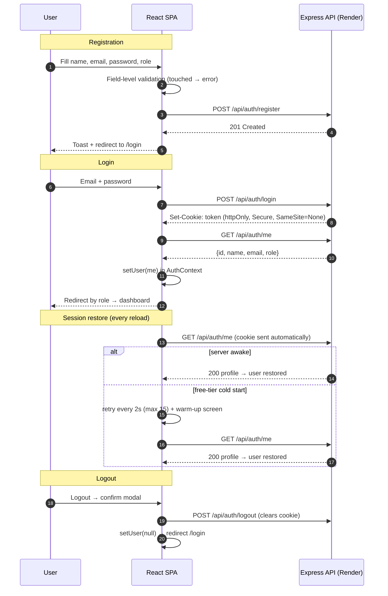

**Notes**

- The JWT never appears in JS — the browser stores it as an `httpOnly` cookie and axios attaches it via `withCredentials: true`.
- The role select on Register offers **Creator** and **Brand** only; admin accounts are not creatable from the UI.
- Login performs a follow-up `/api/auth/me` call so the context holds the full profile, not just the login response.

---

<h2 align="center">Admin Dashboard</h2>

**Route:** `/admin` · **Data:** `GET /api/campaigns/pending` + `GET /api/campaigns`

| UI Section | Behavior |
| --- | --- |
| Hero + stats cards | Live counts of **Pending Reviews** and **Approved Campaigns** |
| Campaign review grid | Pending campaigns as glass cards: title, truncated description, reward, deadline, Pending badge |
| Approve button | `PUT /api/campaigns/:id/approve` → toast, card removed optimistically, approved count +1 |
| Details modal | Full description + meta grid + approve action |
| Empty state | "All Campaigns Reviewed" when the queue is clear |
| Loading | Shimmer skeleton cards |

---

<h2 align="center">Brand Dashboard</h2>

**Route:** `/brand` · **Data:** `GET /api/campaigns`, `GET /api/submissions/campaign/:id`, `PUT /api/submissions/:id/winner`, `POST /api/campaigns`

<h3 align="center">Campaign Brief Launcher</h3>

| Field | Client-side rules |
| --- | --- |
| `title` | Required; 5–50 characters after trim |
| `description` | Required; 20–800 characters after trim |
| `reward` | Required; positive number; minimum **₹500** |
| `deadline` | Required; date input with `min` = tomorrow; must be tomorrow or later |

Submit → `POST /api/campaigns` → toast "Campaign created (pending admin approval)" → form reset → list refresh.

<h3 align="center">Budget &amp; Commission Model (display logic)</h3>

- Remaining budget = **₹50,000 baseline** − Σ(3% × each owned campaign's reward)
- Purely presentational — computed client-side from the campaign list, not from a backend wallet.

<h3 align="center">Submissions &amp; Winner Selection</h3>

1. "View Submissions" on an owned campaign → `GET /api/submissions/campaign/:id`
2. Each pitch card shows creator name, avatar initial, content link, status (Reviewing / 🏆 Winner)
3. "Select Winner" → `PUT /api/submissions/:id/winner` → optimistic status update
4. "View Selected Winner" reveals a winner banner with a **5-second confetti burst** (`react-confetti`)

---

<h2 align="center">Creator Dashboard</h2>

**Route:** `/creator` · **Data:** `GET /api/campaigns`, `GET /api/submissions/mine`, `GET /api/submissions/my-wins`, `POST /api/submissions`

| UI Section | Behavior |
| --- | --- |
| Hero stats | **Total Wins** and **Open Campaigns** counts |
| Congratulations banner | Appears when `wins.length > 0` |
| My Wins & Earnings | Win cards with campaign title, payout amount, link to winning submission |
| Platform fee note | "* 5% platform fee will be automatically deducted upon withdrawal" |
| Latest Campaign Briefs | Marketplace grid; already-submitted campaigns show a green **Submitted** badge instead of the action button |
| Submit Pitch modal | URL input + submission guidelines (1080p, stability, audio, brief match, public link) → `POST /api/submissions` |
| Brief modal | Full campaign details view |

Earnings math lives in [`src/utils/creatorPrizes.js`](src/utils/creatorPrizes.js): it resolves a win's campaign reference against the campaign list (falls back when the API returns an unpopulated id), parses numeric rewards (₹ prefix, `en-IN` locale formatting), and either sums numeric prizes or joins non-numeric ones with `+`.

---

<h2 align="center">API Integration Map</h2>

The frontend consumes **13 of the backend's 24 endpoints**. Dashboard statistics are computed client-side from list endpoints — the backend `/api/analytics/*` routes are currently unused.

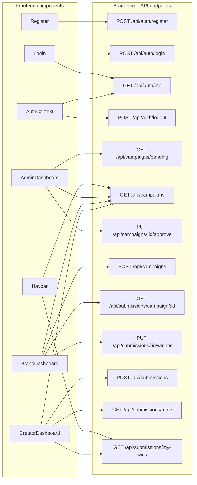

<h3 align="center">Endpoint Usage by Role</h3>

| Endpoint | Register/Login | Navbar | Admin | Brand | Creator |
| --- | :---: | :---: | :---: | :---: | :---: |
| `POST /api/auth/register` | ✓ | | | | |
| `POST /api/auth/login` | ✓ | | | | |
| `GET /api/auth/me` | ✓ (Login, ProtectedRoute, AuthContext) | | | | |
| `POST /api/auth/logout` | | ✓ (via AuthContext) | | | |
| `GET /api/campaigns` | | ✓ | ✓ | ✓ | ✓ |
| `GET /api/campaigns/pending` | | | ✓ | | |
| `PUT /api/campaigns/:id/approve` | | | ✓ | | |
| `POST /api/campaigns` | | | | ✓ | |
| `GET /api/submissions/campaign/:id` | | | | ✓ | |
| `PUT /api/submissions/:id/winner` | | | | ✓ | |
| `POST /api/submissions` | | | | | ✓ |
| `GET /api/submissions/mine` | | | | | ✓ |
| `GET /api/submissions/my-wins` | | ✓ | | | ✓ |

> Unused backend capabilities: `PUT /api/auth/profile`, `PUT /api/auth/password`, `PUT /api/campaigns/:id` (edit), `PUT /api/campaigns/:id/complete`, `PUT /api/campaigns/:id/reject`, `DELETE /api/campaigns/:id`, `PUT /api/submissions/:id/review`, and all three `/api/analytics/*` routes.

---

<h2 align="center">Client-Side Validation</h2>

All forms follow the same **touched/error pattern**: a field validates only after first blur; from then on it re-validates on every keystroke; the submit button disables while any visible error exists.

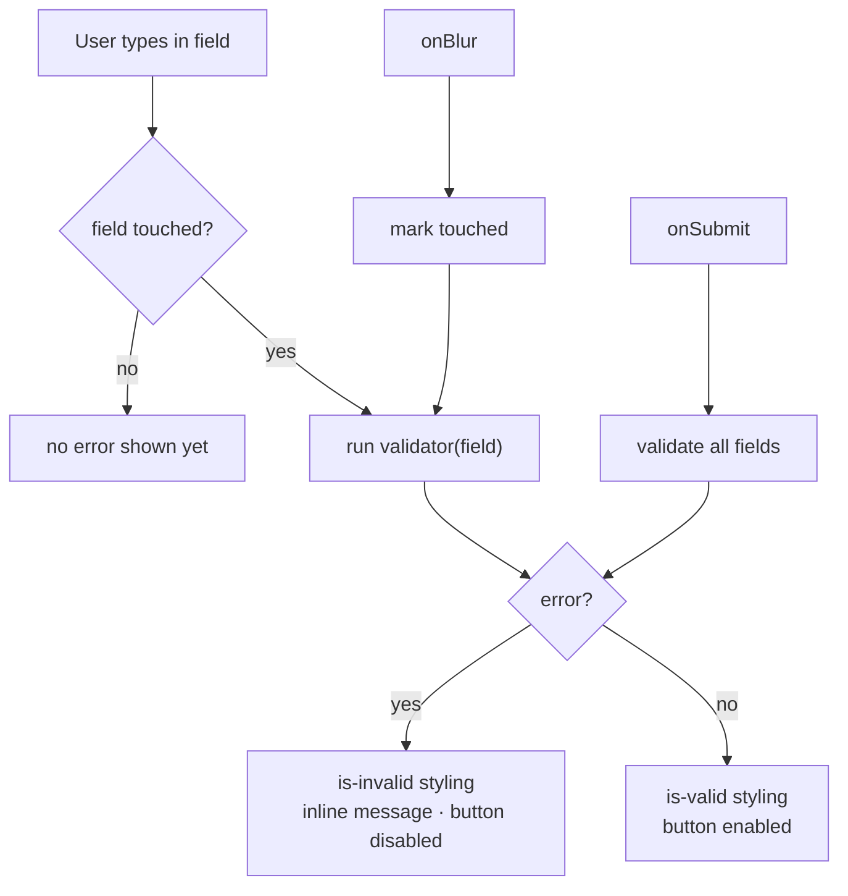

<h3 align="center">Validation Matrix</h3>

| Form | Field | Rule |
| --- | --- | --- |
| Login | email | Required; regex `^[^\s@]+@[^\s@]+\.[^\s@]+$` |
| Login | password | Required; ≥ 6 characters |
| Register | name | Required; ≥ 2 characters after trim |
| Register | email | Required; same email regex |
| Register | password | Required; ≥ 6 characters |
| Register | role | Select: `creator` \| `brand` (no admin) |
| Brand campaign | title | Required; 5–50 characters after trim |
| Brand campaign | description | Required; 20–800 characters after trim |
| Brand campaign | reward | Required; positive number; ≥ ₹500 |
| Brand campaign | deadline | Required; tomorrow or later (`min` attribute blocks past dates in the picker) |
| Creator submit | contentUrl | Required; `type="url"` browser check (server re-validates the `http(s)` format) |

<h3 align="center">Frontend vs Backend Bounds</h3>

The client applies **stricter** rules than the API — a deliberate UX decision; the backend remains the source of truth:

| Field | Frontend | Backend |
| --- | --- | --- |
| Campaign title | 5–50 chars | 3–150 chars |
| Campaign description | 20–800 chars | 10–3000 chars |
| Campaign deadline | tomorrow+ | ≥ 1 hour ahead |
| Password | ≥ 6 chars | ≥ 6 chars + one letter + one number |

---

<h2 align="center">Cold-Start Resilience</h2>

The backend runs on Render's free tier, which spins down after ~15 minutes of inactivity and can take 20–50 seconds to answer its first request. The current build handles this with **time boxing rather than polling** — every request is capped by axios at 12 seconds, and session restore makes exactly one attempt:

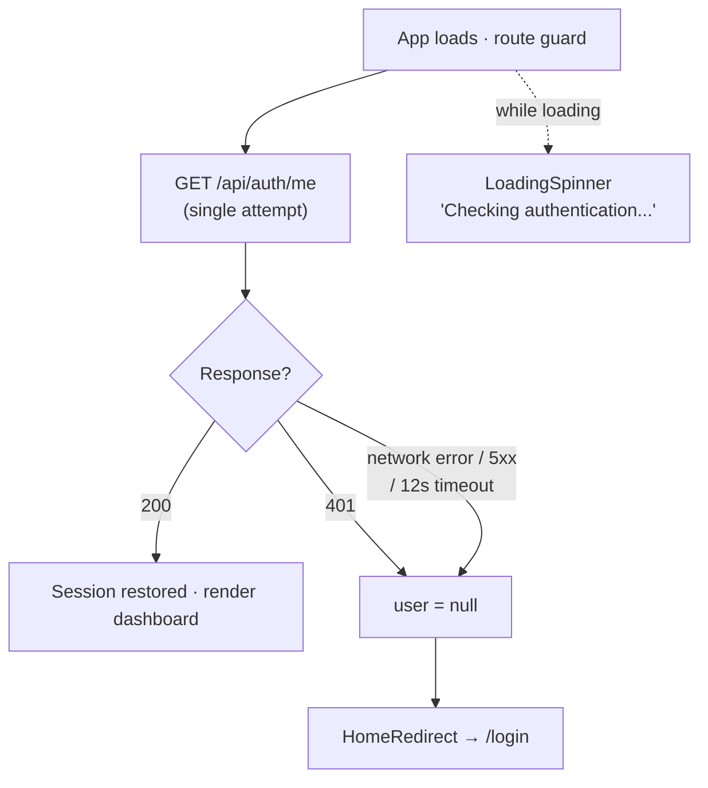

Earlier versions polled `/api/auth/me` up to 15 times × 2s behind a full-screen "warming up the server" splash. That has been removed: the app now resolves to the logged-out state quickly, and if the API wakes up afterwards the login form simply works. The trade-off is that a sleeping server during a **dashboard** fetch produces an error toast instead of an automatic retry — the user refreshes or resubmits (tracked in [Known Limitations](#known-limitations)).

---

<h2 align="center">Winner Selection Flow</h2>

The flagship end-to-end interaction across all three roles:

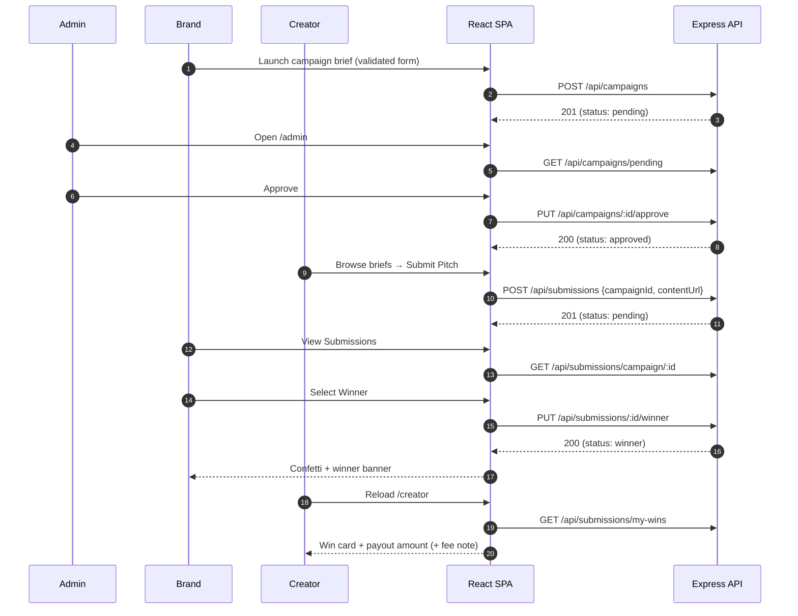

---

<h2 align="center">Styling &amp; Design System</h2>

A single **glassmorphic dark theme** across the app, expressed in two layers:

1. **Global stylesheet** — [`src/styles/global.css`](src/styles/global.css) (2,170 lines): design tokens, reset, navbar, split-screen auth layout, canvas layer, logout modal, buttons.
2. **Scoped inline styles** — each dashboard renders its own `<style>` block with a prefixed variable namespace (`--admin-*`, `--b-*`, `--c-*`) so three premium themes coexist without collisions.

| Design token family | Example | Used by |
| --- | --- | --- |
| `--admin-*` | `--admin-bg: #0b081a` | AdminDashboard |
| `--b-*` | `--b-primary: #7c3aed` | BrandDashboard |
| `--c-*` | `--c-gold: #fbbf24` | CreatorDashboard |
| `--purple-*`, `--white-*` | `--purple-2: #7c3aed` | global.css |

**Signature elements**

- Dark violet backgrounds (`#0a071b` / `#070514` / `#0b081a`) with blurred, floating ambient glow blobs (purple / indigo / pink)
- Glass cards: `rgba(255,255,255,0.03)` surfaces + `backdrop-filter: blur(16px)` + hairline borders
- Neon gradient action buttons (`#7c3aed → #4f46e5`) with hover lift and glow
- Shimmer skeleton loading cards; animated empty states
- Gradient hero titles; uppercase micro-labels; gold (`#fbbf24`) for reward/winner accents
- Fonts: **Outfit**, **Plus Jakarta Sans**, **Inter** (system fallbacks)
- Canvas particle-network animation on auth pages (28 particles, ≤110px link distance, purple)
- Responsive breakpoints at 768px; `en-IN` locale number formatting for rupee amounts

---

<h2 align="center">Codebase Distribution</h2>

~**6,200 lines** of source across 14 files. The dashboards are the heart of the app — the three page components plus their inline styles account for roughly half the codebase.

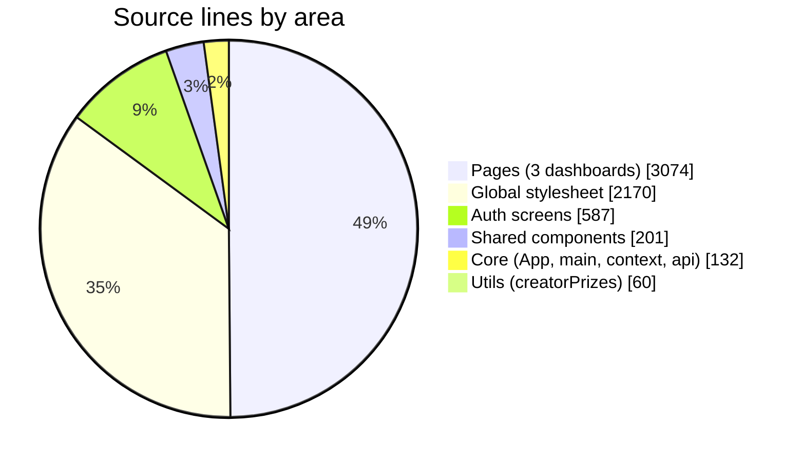

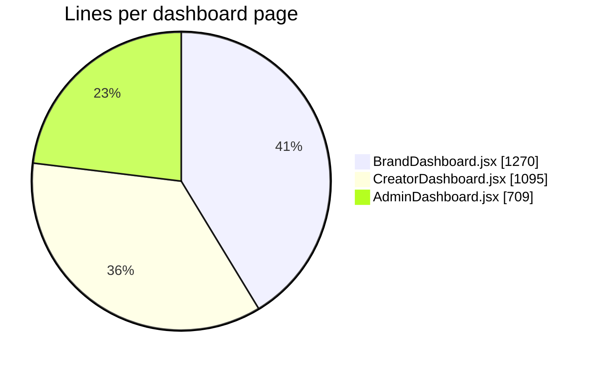

> Note: each dashboard's inline `<style>` block is included in its line count — the rendered UI plus `global.css` make CSS roughly half the project.

---

<h2 align="center">Getting Started</h2>

<h3 align="center">Prerequisites</h3>

- **Node.js 20.19+** (or 22.12+) — required by Vite 7
- The BrandForge backend running locally (`http://localhost:5000`) or reachable at its Render URL — see the backend repository's README for setup

<h3 align="center">Installation</h3>

```bash
# 1. Clone the repository
git clone <repository-url>
cd BrandForge_Frontend

# 2. Install dependencies
npm install

# 3. Start the dev server
npm run dev
```

The app runs at `http://localhost:5173`.

> **Local API note:** the axios base URL is hardcoded to the deployed backend. To develop against a local backend, change `baseURL` in [`src/api/axios.js`](src/api/axios.js) to `http://localhost:5000` — and make sure the backend's CORS allowlist already includes `http://localhost:5173` (it does).

<h3 align="center">Available Scripts</h3>

| Command | Description |
| --- | --- |
| `npm run dev` | Vite dev server with Fast Refresh |
| `npm run build` | Production build to `dist/` |
| `npm run preview` | Preview the production build locally |
| `npm run lint` | ESLint over the project |

---

<h2 align="center">Configuration</h2>

There are **no environment variables** in use. All runtime configuration lives in [`src/api/axios.js`](src/api/axios.js):

```js
const api = axios.create({
  baseURL: "https://brandforge-backend.onrender.com",
  withCredentials: true, // sends the httpOnly JWT cookie
  timeout: 12000, // 12s cap — a cold Render instance surfaces as a toast
});
```

Changing environments means editing the `baseURL` line (see [Roadmap](#roadmap) for the planned `VITE_API_URL` migration). The 12-second timeout is what makes Render's free-tier cold starts fail fast into a toast instead of hanging the UI indefinitely.

---

<h2 align="center">Deployment</h2>

The frontend deploys to **Vercel** as a static SPA.

1. Import the repository into Vercel — the Vite preset is auto-detected (`npm run build` → `dist/`).
2. [`vercel.json`](vercel.json) rewrites every path to `/index.html` so React Router owns client-side navigation:

   ```json
   { "rewrites": [{ "source": "/(.*)", "destination": "/index.html" }] }
   ```

3. The live origin (`https://brand-forge-frontend.vercel.app`) is already on the backend's CORS allowlist.
4. HTTPS is mandatory: the auth cookie is `Secure; SameSite=None`, which browsers only accept cross-site over HTTPS. (localhost is treated as a secure context.)

---

<h2 align="center">Conventions</h2>

- **Components** — one default-exported function component per file; hooks only; no classes.
- **Data fetching** — always through the shared `api` instance; never raw `fetch`; errors surface as toasts with `err.response?.data?.message` preferred.
- **Validation** — the touched/error pattern (see [Client-Side Validation](#client-side-validation)); every form disables its submit button while invalid.
- **Styling** — global.css for shared chrome; namespaced inline `<style>` blocks with a per-dashboard prefix for dashboard themes; class names follow the prefix (`b-`, `c-`, `admin-`).
- **IDs** — user and object ids can arrive as `_id`, `id`, or populated objects; use the `getIdValue` / `getCampaignIdFromRef` coercion helpers rather than assuming a shape.
- **Dates & money** — `toLocaleDateString` for deadlines; `toLocaleString("en-IN")` for rupee amounts.

---

<h2 align="center">Known Limitations</h2>

1. **API base URL is hardcoded** in `src/api/axios.js` — switching between local and deployed backends requires a code edit.
2. **Dashboard stats are client-computed.** The backend's `/api/analytics/*` endpoints are unused; win counts and campaign totals derive from list endpoints.
3. **Brand "Remaining Budget" is cosmetic** — a ₹50,000 baseline minus 3% commission per campaign, with no backend wallet to back it.
4. **Validation lives inside each component** — Login, Register, and the campaign form duplicate similar logic instead of sharing validators.
5. **Cold-start retry is fixed** at 15 × 2s and applies only to `/api/auth/me`; other dashboards' initial fetches can fail with an error toast during a cold start.
6. **Campaign editing, rejection, completion, deletion, and submission review/feedback have no UI** — those backend endpoints are unexposed.
7. **No TypeScript, no test suite, no CI** — `npm run lint` is the only static check.
8. **Inline `<style>` blocks bloat the page components** (~600–900 lines each); they ship with the JS bundle and are re-parsed per mount.

---

<h2 align="center">Roadmap</h2>

- [ ] Move the API base URL to a `VITE_API_URL` environment variable
- [ ] Extract a shared form-validation utility (reusable touched/error pattern)
- [ ] Surface the backend analytics endpoints in the dashboards
- [ ] Add submission review/feedback UI for brands
- [ ] Add campaign edit/complete/reject actions to the brand and admin dashboards
- [ ] Extract dashboard inline styles into CSS modules
- [ ] Add an error boundary around route outlets
- [ ] Add Playwright/Vitest smoke tests for auth and the three dashboards
- [ ] Toast-driven retry for cold-start failures on dashboard fetches

---

<h2 align="center">Contributing</h2>

1. Branch from `main` using a descriptive name (e.g., `validations`, `feat/xyz`).
2. Follow the existing commit style: `feat(scope): summary`, `fix(scope): summary`, `style(scope): summary`.
3. Keep the touched/error validation pattern for any new form.
4. Route all HTTP through the shared axios instance.
5. Run `npm run lint` before opening a pull request.
